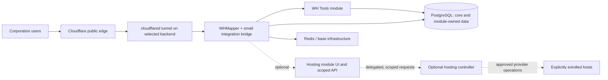

# WHMapper with two modules — proposed build blueprint v2

Status: owner-directed planning candidate, not an accepted implementation or a tested application. Creator: VelesPhylakos. Public concept: Some Time Later Corp. Private future build: Eve-Cloud. No app implementation, cloud provisioning, paid service or existing-server access was performed while producing this document.

## 1. Direction and evidence

The owner requested that our changes become two mods to EVE-WHMapper: one for tools and one for hosting. This replaces MAP-042's proposed new-application-first recommendation. The selected **planning base** is `pfh59/eve-whmapper` commit `2a493fad9acec9a8e15b619f7943ae8b6e7f30da`. Preserve its MIT notice and inspect applicable dependency/asset/game-data terms before distribution. Pathfinder remains a source of design references; PHP components are not embedded into the .NET process.

The base project file targets .NET 10 and declares EF Core/Npgsql packages; its supplied Compose example uses PostgreSQL 17 and Redis 8. These are inspected declarations, not a resolved dependency lock or measured operating requirement. Build from the pinned source, resolve and record package locks/image digests in the authorised implementation phase, and preserve a third-party notice inventory. Do not use a mutable `latest` image as the release identity.

MAP-049 is the reconciled 35-entry evidence register. Its documented/inspected claims are distinct from proposed policy, unavailable evidence and runtime verification. Original reports MAP-043..048 and the older blueprint remain immutable history. References E01..E35 resolve through that register; integration source evidence is supplied alongside this blueprint. Old A/B/C option letters are report-local, not shared identifiers.

## 2. Architecture



Cloudflare is the midpoint for public web traffic. The backend profile may be Oracle Always Free, a later separately approved server or another provider. A backend deployment does **not** require the Hosting module: the mapper and Tools module must run with Hosting disabled. The owner's existing server remains out of the current work.

There are exactly two user-facing modules:

| Module | Responsibility | Exclusions |
|---|---|---|
| WH Tools | Source/time/uncertainty annotations, stale/conflict visibility, route explanations and related operator workflows | Rebuilding an existing mapper, guaranteed hostile detection, exact remaining mass, autonomous game control |
| Hosting | Opt-in host offers, capability/health inventory and explicit request/approval workflows; later scoped controller integration | Mandatory cloud coupling, unrestricted shell, automatic purchases/upgrades, silent self-destruction of the active backend |

The **integration bridge** is shared glue, not a third product/module. It translates base identity/map services and approved observations into typed module interfaces, adds module navigation, registers module services/UI and enforces authorization on every operation/event. Each module is independently versioned and enabled; compatible releases are compiled and tested with an explicitly pinned base version.

## 3. Honest meaning of “mod”

Inspected `Program.cs` registers database/mapper services and maps Razor components and a notification hub. `Extensions/MapperServiceExtensions.cs` uses explicit service registration. These inspected files do not demonstrate a general runtime plugin loader or a published stable third-party plugin ABI. The design therefore proposes **compile-time modules plus a small maintained integration patch**. It does not promise drop-in DLL loading, hot installation or upstream-supported plugins.

Keep module projects outside base implementation folders. Proposed private layout:

```text
upstream/WHMapper/               pinned upstream source/maintained derivative
modules/WhTools/                independently versioned tools library/UI
modules/Hosting/                independently versioned hosting library/UI
integration/WhMapperBridge/     adapters, registration and integration patch
services/HostingController/    optional separate service, not loaded by default
tests/                          module, adapter and end-to-end verification
deploy/                         provider profiles and pinned release manifests
```

This is a future layout, not created implementation. Preserve upstream attribution/history pins; do not assume a public GitHub fork can simply be changed into a private fork. Existing public/private repositories remain the two project repositories.

The first implementation spike must compile the untouched base and a no-op bridge with both modules disabled, then prove navigation, authorization, events and data migrations with an empty Tools module. If these seams cannot be isolated, record the exact required patch and review it before adding features. Never present the planned integration seam as already supported.

## 4. Typed identity and data boundaries

This version supersedes MAP-042's proposed all-UUID replacement of core entities. The inspected base uses integer map/system/instance IDs; `WHMap.WHInstanceId` is nullable. Preserve those types and existing rows. Modules must reject an orphan/unresolved map instead of inventing an instance or treating null as public.

| Type | Proposed fields and invariants |
|---|---|
| CoreMapRef | `instanceId: integer > 0`, `mapId: integer > 0`; database lookup proves map belongs to that instance and actor has base access |
| CoreSystemRef | CoreMapRef plus `systemId: integer > 0`; lookup proves `WHSystem.WHMapId == mapId`; external solar-system ID is a different identifier |
| ModuleRecord | `id: UUID`, CoreMapRef where map-scoped, `revision: integer >= 1`, UTC create/update times, server-derived author, schema version; no substitution for core PKs |
| ModuleGrant | instance/map scope, verified EVE character/entity identity, module capability, explicit grant/revoke state and revision |
| ObservationAnnotation | ModuleRecord plus optional CoreSystemRef or core connection reference, source kind/reference, observedAt, recordedAt, uncertainty and optional superseded annotation ID |
| HostingRequest | separate hosting tenant/instance scope, request UUID, explicitly enrolled host/offer, allowlisted operation, expected revision, idempotency key and approval/expiry record |

Module grants can narrow base access, never expand it: `baseAllows(resource, actor) AND moduleAllows(capability, actor, resource)`. A module never trusts an actor/tenant ID merely because the browser supplied it. Hosting operator authority is separate from corporation map-admin authority. Base login does not grant cloud-management rights.

Use module-owned tables/schema and a separate migration history; do not make a module install rewrite base identity columns or silently alter base ACL defaults. Enforce map ownership on every read/write/export/event/cache key, not only create. Module-owned sidecar data is independently exportable, but restore consistency must include referenced base IDs/revisions. Deletes retain module audit/tombstone history under a reviewed retention policy; uninstall is not silent purge.

## 5. Proposed adapter contracts

These names define our boundary, not existing WHMapper APIs:

| Boundary | Contract |
|---|---|
| CoreIdentity | Returns verified actor/session and instance context; no raw credential returned to a browser/module UI |
| MapAuthorization | Evaluates base map access, then explicit module capability; denies unresolved/orphan maps; cannot substitute a global access-handler success for a per-map decision |
| ObservationFeed | Shares already-authorized core observations and their timestamps; no duplicate polling client; module consent revocation stops module collection/delivery |
| RevisionWriter | Checks expected revision and idempotency atomically for module records; base writes use supported adapter transaction or reviewed patch, never direct unsynchronized SQL |
| EventPublisher | Sends only authorized map-scoped changes; revocation removes subscriptions and invalidates cached private payloads |
| HostGateway | Hosting-only scoped request/receipt; no caller-controlled shell command, unrestricted URL or cloud account key |

Identity-provider scopes, upstream code behavior and our proposed module contracts must not be conflated. E06/E07 show a token-provider failure path where local clearing follows successful remote revocation. The integration patch must make local session/consent/cache shutdown deterministic even when remote revocation fails, and report remote revocation as pending/failed. Whether base tracking also stops must be tested and stated separately; “module sharing off” must not falsely promise global base logout.

## 6. Facts, decisions and build gates

| Prior OD entry | Current treatment |
|---|---|
| OD-01 concurrency | Proposed module default: optimistic revisions and visible conflicts; no silent last-write-wins. Base behavior needs adapter tests |
| OD-02 stack | Owner direction now favours extensions to WHMapper; inherit its inspected .NET target for this planning base, rather than authoring a new PHP/.NET mash-up |
| OD-03 API contract | E01..E15 document/inspect scoped metadata and compatibility date `2026-08-18`; implementation/registration/validation tests still required |
| OD-04 dependencies | Composer declared lock metadata now available; .NET exact resolution and all applicable licence/security checks remain implementation/release gates |
| OD-05 terms/assets | Retain notices; review separate CCP/dependency/asset/data terms before distribution or any paid/ISK scheme; no approval inferred |
| OD-06 uncertainty | Consume observations with timestamps; display unknown values; proposed warning/poll policies are configuration, not game constants |
| OD-07 token handling | Implement/test local shutdown, secure token custody and remote-revocation error reporting; no claim these fixes already exist |
| OD-08 recovery | A concrete restore qualification is in the build/test plan; passing evidence requires a built environment |
| OD-09 authorization | Handler delegation is inspected but not full endpoint/map enforcement; every adapter/read/write/event requires negative tests |
| OD-10 bootstrap | Proposed one-time explicit module-owner pairing, tied to verified instance creator/admin plus operator approval; no empty-table self-claim endpoint |
| OD-11 signature length | Preserve selected base constraint `StringLength(7)` initially; this is compatibility with this base, not a universal EVE rule |
| OD-12 database | Selected planning base declares PostgreSQL through Npgsql; module storage follows it. Exact deployment image/lock and restore remain gates |
| OD-13 access default | Base behavior stays visible; module data defaults to explicit module grants AND base permission, not a silent rewrite of base ACL semantics |
| OD-14 consent | Proposed module default off; explicit character/map sharing, revoke/unlink and cache/subscription invalidation; base consent UI must be distinguished |

These defaults make the proposed plan concrete; they are not a claim of independent acceptance or permission to start implementation. Operator/domain/tenancy choices, release terms, measured capacity and runtime acceptance remain explicit gates, not “research unknown” filler.

## 7. Navigation

Read the Tools specification, Hosting specification, build/test plan, and Oracle/Cloudflare deployment option alongside this master. The evidence register and integration source pack establish source provenance. The build plan defines acceptance artifacts; documents do not replace those tests.
