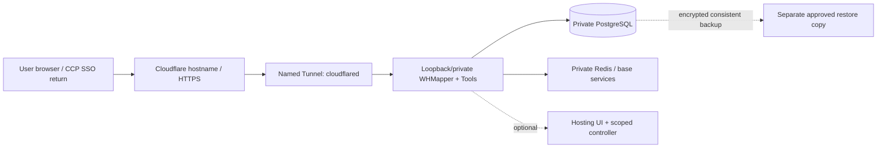

# Oracle backend behind Cloudflare — optional pilot profile

Research date: 2 November 2026. Scope: a proposed online backend for the selected mapper/module architecture. No account was accessed, free entitlement confirmed for the owner, VM created, tunnel configured, terms accepted, payment made or existing server contacted. The recommendation is conditional on the qualification checks below.

## 1. Current primary-source observations

| ID | Source and narrow observation | Validity |
|---|---|---|
| OCI-01 | [Oracle Always Free resources](https://docs.oracle.com/en-us/iaas/Content/FreeTier/freetier_topic-Always_Free_Resources.htm): current A1 allowance is 1,500 OCPU-hours/9,000 GB-hours monthly, described as 2 OCPUs/12 GB total; home-region capacity can be unavailable and idle resources can be reclaimed | Provider documentation observed 2 November 2026, not this account's entitlement or available capacity |
| OCI-02 | [Oracle Free Tier](https://docs.oracle.com/en-us/iaas/Content/FreeTier/freetier.htm): time-limited trial credits are separate from Always Free; signup commonly needs phone/card; charging requires upgrade; excess trial A1 allocations can be removed after trial | Recheck current account/terms and allocation before provision; no upgrade authorised here |
| CF-01 | [Cloudflare Tunnel](https://developers.cloudflare.com/tunnel/) documents an outbound-only connector and availability on all plans | Product availability does not establish a complete zero-cost deployment |
| CF-02 | [Tunnel setup](https://developers.cloudflare.com/tunnel/get-started/) requires a Cloudflare account/domain, internet-capable origin and outbound port 7844 | Confirm actual domain/account and origin egress; a domain may have its own cost |
| CF-03 | [Cloudflare WebSockets](https://developers.cloudflare.com/network/websockets/) documents support on all plans and SignalR; WAF inspection is at the opening handshake, not every established frame | End-to-end behavior and reconnect still need tests |
| MS-01 | [ASP.NET Core proxy guidance](https://learn.microsoft.com/en-us/aspnet/core/host-and-deploy/proxy-load-balancer?view=aspnetcore-10.0) describes explicit forwarded-header/proxy trust configuration outside IIS | Apply/test for the chosen topology; never trust arbitrary Internet forward headers |

Older references can advertise 4 OCPUs/24 GB; this profile does not rely on that older figure. Revalidate the current service-specific docs and Console allowance before sizing. These are documented facts/limits as observed, not permanent promises or accepted service terms.

## 2. Proposed topology

Run the app and its PostgreSQL/Redis dependencies on the chosen VM initially, using internal/loopback/container-only service bindings. Cloudflare remains the public midpoint and tunnels to the web origin. Oracle's separate managed database products are not assumed to be drop-in PostgreSQL substitutes. This is a single-VM pilot, not high availability.

A tunnel removes the need to expose inbound **application** ports; the VM still needs outbound connectivity. Confirm public-IP/egress/NAT/storage implications before provision rather than assuming a private subnet includes free outbound NAT. Keep the database and controller management interfaces off public ingress. Establish a separately approved administrative path; do not open unrestricted SSH to make a diagram work.

## 3. Cloudflare and authentication rules

Use a stable named tunnel and an owned/approved hostname so the CCP SSO registered return URL is stable. Cloudflare is a transport/security edge, not a replacement for CCP identity or module/map authorization. If extra Access policies protect administration, ensure they do not accidentally break the public SSO flow or the mapper's real-time connections.

Bypass public caching for authenticated HTML, APIs, login/return paths and real-time negotiation/event routes; cache only explicitly public immutable assets. Trust forwarded scheme/client headers only from the configured connector/proxy boundary, preserve HTTPS return URLs and secure cookie behavior, and test forged-header rejection. A valid edge request still needs server-side tenant/module/consent checks.

Both Blazor interactive traffic and the base notification hub require qualified real-time transport behavior. Test WebSocket negotiation, tunnel/backend restart and reconnect authorization. A working initial HTTP page does not prove SignalR or map isolation works. Do not expose provider keys or tunnel tokens to browsers; store them under operator custody outside Git and rotate them independently.

## 4. Resource and recovery policy

Treat 2 OCPUs/12 GB as an upper documented free envelope to confirm, not a measured app requirement. Pin/build ARM64-compatible app, .NET/native dependency, PostgreSQL, Redis and connector artifacts; inspect image manifests and execute the base/bridge checks on that architecture. An amd64 image tag or untested `latest` is not ARM evidence. Smaller AMD micro instances have no qualified capacity claim in this design.

Observe real memory/CPU/disk/connection/latency under the explicitly proposed pilot target before admitting live users. Put resource/disk/log retention ceilings on each process and retain headroom; exact limits come from that measurement. If the profile does not fit or capacity is unavailable, stop and report the blocker. Do not silently upgrade to paid services or inflate workload to avoid idle reclaim.

Before storing live private data, make an encrypted, consistent backup of base+module data and required recovery configuration, place an approved restore copy outside this single failure domain, and demonstrate isolated restore. The destination, quota/cost, key custody and retention must be chosen explicitly; neither Cloudflare nor a second volume on the same reclaimed VM is automatically an independent backup. A laptop-held encrypted copy can be a manual early option only if its refresh/recovery ownership is accepted.

## 5. Qualification gates

1. Owner confirms tenancy/home region, current Always Free shape/remaining quota, domain and storage/egress/backup allowances; no paid upgrade or extra product is implied.
2. Pin architecture-specific images/locks and compile the selected base plus no-op bridge; measure fit before enabling features.
3. Verify public HTTPS/SSO callback, origin bypass denial, private database bindings, trusted proxy headers and private-cache bypass.
4. Run M-T10/M-T11 real-time/reconnect/authorization checks; preserve consent and module isolation after reconnect/restart.
5. Run M-T12 load and isolated recovery checks, including actual base integer references, module UUIDs, grants and keys; retain evidence.
6. Approve the pilot operating/recovery runbook. The Hosting module may remain off or read-only; it cannot destroy its own backend or purchase capacity.

Conclusion: Oracle Always Free is a plausible **optional pilot origin behind Cloudflare**, subject to these gates. It is not evidence of free guaranteed production hosting, a qualified deployment or a replacement for backup/operations.
